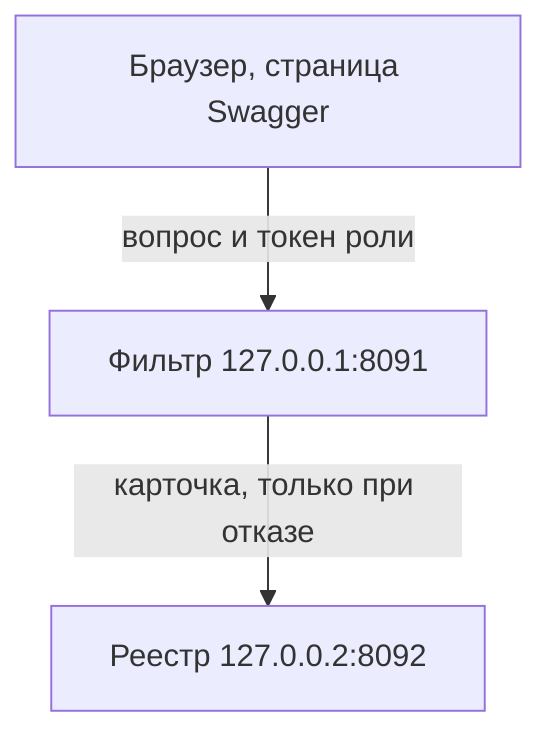
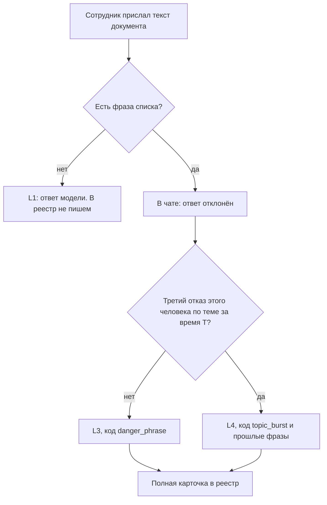
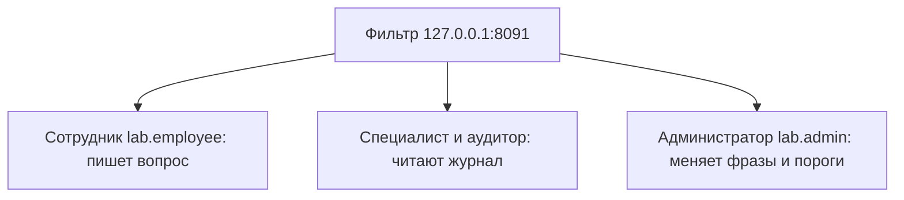
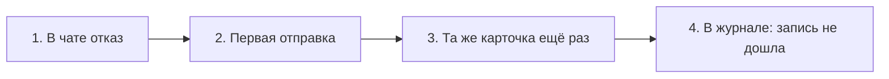

# Что говорить на защите

Система «Вывод → Реестр». Сначала смысл и схемы, потом речь на 3–4 минуты. Отчёт целиком читать не нужно. Если попросят показать руками, нажать стенд.

Перед парой, из папки `prototype`:

```powershell
python serve.py
```

Окно не закрывать. В браузере заранее открыть http://127.0.0.1:8091/docs и http://127.0.0.2:8092/docs .

---

## О проекте

Сотрудник спрашивает локальную модель по тексту документа. В тексте может стоять фраза, которую ему показывать нельзя: «пароль», «ключ доступа», «закрытый узел». Система ловит такую фразу до выдачи ответа.

Зачем это нужно. Обычный чат отдал бы кусок документа вместе с ответом. Здесь выдача останавливается, а специалист потом открывает журнал и видит, кто спрашивал, по какой теме и какая фраза нашлась. Кнопки «всё равно показать ответ» нет.

Как это закрывает требования заявки.

| Требование | Что сделано на стенде |
| --- | --- |
| П-1. Текст с «пароль» до сотрудника не доходит | В чате одна строка: «ответ отклонён» |
| П-2. Фразу ищут в документе до выдачи | Фильтр смотрит текст и только потом решает, что показать |
| П-3. В журнале есть кто, вопрос и место фразы | Карточка: пользователь, вопрос, тема, фраза, кусок текста |
| П-4. Три отказа одного человека по одной теме связаны | Третий за время T — уровень L4, код `topic_burst` |
| П-5. Специалист смотрит журнал, когда сам решил | Журнал на `127.0.0.1:8091`, токен `lab.specialist` |
| П-6. Запись может не дойти | Вторая отправка, затем пометка «запись не дошла» |
| Правило A | Нет фразы — L1 и ответ. Есть фраза — отказ |
| Правило B | Сначала отказ в чате, потом карточка в реестр |
| Правило C | Первые два отказа по теме — L3, третий за время T — L4 |
| Два адреса | Люди на `127.0.0.1:8091`, реестр на `127.0.0.2:8092` |
| Проверка | Swagger и `python tests/check_scenarios.py` |

Запросов 31: 19 у людей и 12 у реестра. В реестр попадает только принятая карточка отказа. Список фраз живёт в файле настроек и в базу реестра не копируется.

### Два адреса

Человек ходит только на фильтр. Фильтр сам пишет в реестр, и только если был отказ.



На фильтре проверяют роль и ищут фразу. На реестре ролей нет. Туда пускает ключ `lab-service`.

### Один вопрос



### Кто куда ходит

Пароль у всех входов `lab`. Чужая роль получает 403, реестр при этом не вызывается.



### Если карточка не дошла

Отказ в чате уже показан. Запись идёт следом.



---

## Речь

Я сделала учебный стенд информационной системы «Вывод → Реестр» по заявке в этой папке.

Смысл простой. Сотрудник задаёт вопрос по тексту документа. Фильтр смотрит, есть ли в тексте фраза из списка администратора. На стенде их три: «пароль», «ключ доступа», «закрытый узел».

Если фразы нет, сотрудник видит ответ модели, и в реестр ничего не пишется.

Если фраза есть, сотрудник видит только строку «ответ отклонён». Фразу, уровень и кусок документа ему не показывают. Полная карточка уходит в реестр: кто спросил, какой вопрос, какая тема, какая фраза и где она стояла в тексте.

Дальше схема «Два адреса» в начале этого файла. Это три уровня, как на стенде учебных поручений.

Человек сидит в браузере и ходит только на фильтр, адрес `127.0.0.1`, порт `8091`. Здесь проверяется роль и ищется фраза.

Реестр слушает другой адрес, `127.0.0.2`, порт `8092`. Ролей он не знает. К нему ходит только фильтр, со служебным ключом `lab-service`.

Запросов 31: 19 у людей и 12 у реестра. В реестре нет чата и нет списка фраз. Туда попадает только принятая карточка отказа.

Роли четыре, пароль у всех `lab`.

Сотрудник пишет вопрос. Это `user_17`, токен `lab.employee`.

Специалист и аудитор читают журнал.

Администратор меняет список фраз и пороги. Журнал он не открывает.

Чужая роль получает код 403. До реестра такой запрос не доходит.

Уровня L2 нет. Их три.

L1 — фразы в тексте нет, ответ выдан, карточки нет.

L3 — фраза найдена, в чате отказ, в реестре полная карточка. Код `danger_phrase`.

L4 — третий отказ того же человека по той же теме за время T. В чате та же строка «ответ отклонён». В карточке код `topic_burst` и прошлые фразы. Для сотрудника второй и третий отказ выглядят одинаково. Разницу видит специалист.

Если реестр карточку не принял, фильтр отправляет её ещё раз. Если и второй раз не дошла, в журнале стоит «запись не дошла». Отказ в чате при этом уже показан.

Живая модель здесь не нужна. Ответ модели на стенде — готовая строка.

Проверка две. Запросы можно нажать в Swagger. Те же шаги гоняет `tests/check_scenarios.py`.

---

## Если показывают стенд

Говорить по ходу кликов. Четыре фразы хватает.

1. На странице людей: `POST /auth/login`, логин `employee`, пароль `lab`. «Вот вход. Токен `lab.employee`, это пользователь `user_17`.»
2. Authorize, вставить `lab.employee` без слова Bearer.
3. `POST /chat/messages`, пример уже с фразой «пароль». «В документе есть „пароль“. Сотрудник в ответе видит только „ответ отклонён“. Слова „пароль“, уровня и кода в этом ответе нет.»
4. Перейти на `127.0.0.2:8092`, Authorize, ключ `lab-service`, `GET /db/v1/cards`. «Та же ситуация в реестре. Здесь уже есть фраза, кусок текста, код `danger_phrase` и уровень L3.»

Этим граница показана: человек получил отказ, карточка со смыслом лежит на втором адресе.

---

## Если спросят

**Почему 31 запрос, а не 40?**  
В реестре хранятся только принятые карточки. Чат, список фраз и журнал вызовов живут у фильтра. Дублировать их во второй базе не нужно.

**Где список фраз?**  
В файле `config/settings.txt`. В базу реестра он не копируется. Постоянно его меняют в `settings.example.txt`: при запуске стенд заново копирует example поверх `settings.txt`.

**Почему сотрудник не видит причину?**  
Так задано в заявке. Причина нужна специалисту в журнале, а не в чате.

**Что такое L4?**  
Три отказа одного `user_17` по одной теме за время T. Первые два — L3, третий — L4. В чате строка та же.

**Что если реестр молчит?**  
Чат уже отказал. Фильтр пробует второй раз. Потом в журнале «запись не дошла», в реестре новой строки нет.

**Чем проверено?**  
Сценарии в `prototype/tests/check_scenarios.py`: чистый документ, фраза, три отказа, журнал, молчащий реестр, новая фраза администратора и чужая роль.

**Где править, если что-то менять?**  
В отчёте раздел 13: что менять и в каком файле. Роли — `src/rights.py`, поиск фразы — `src/phrases.py`, уровень L3 или L4 — `src/ui_chat.py`.

---

## Чем закончить

Стенд показывает границу системы из заявки. Фильтр решает, можно ли отдать ответ. Реестр только хранит карточку отказа. Человек в реестр сам не ходит.
