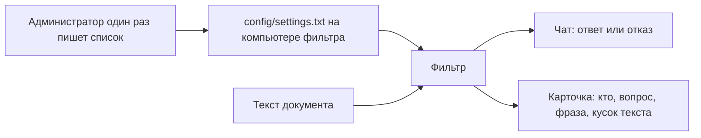
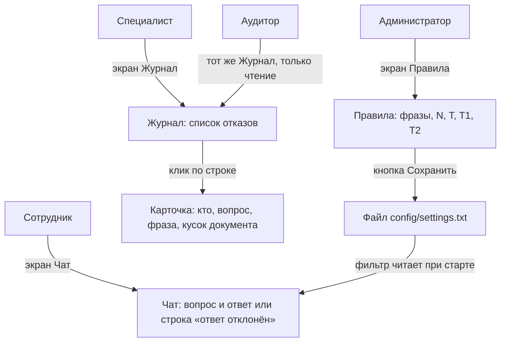
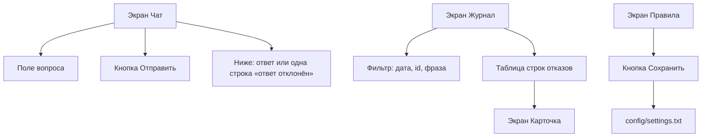
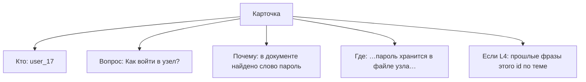
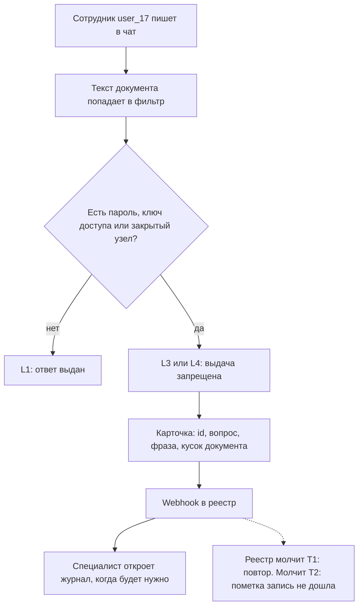
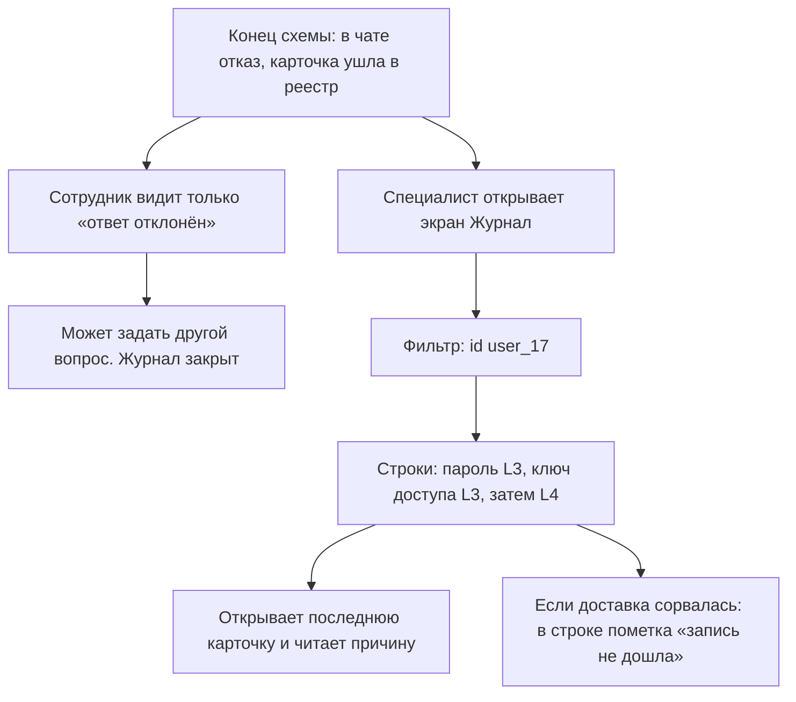
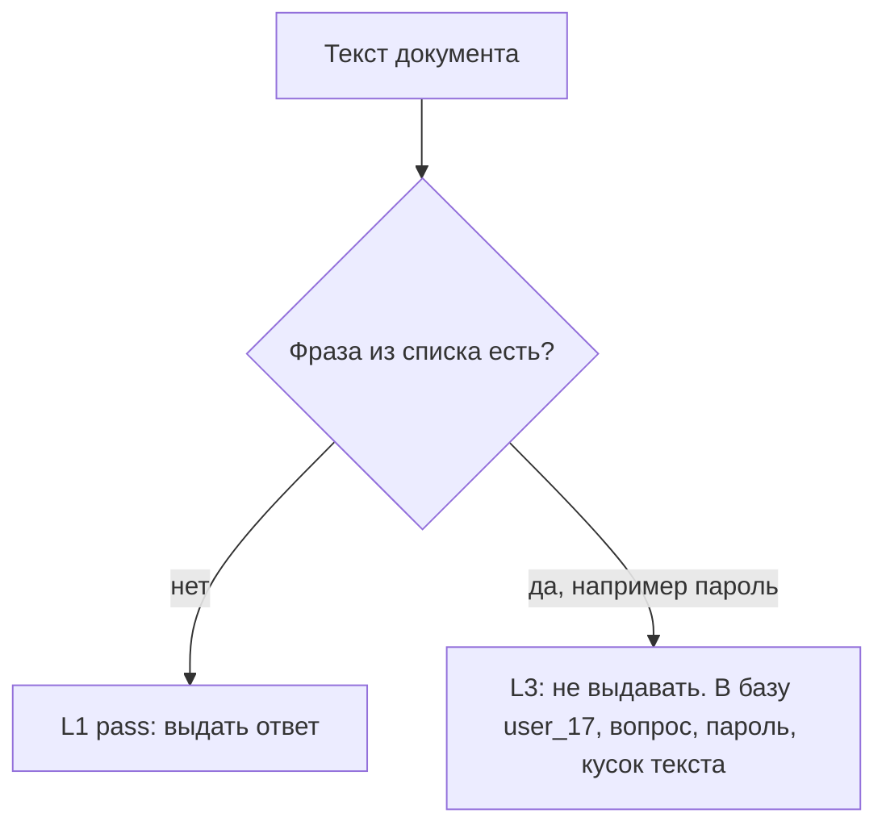
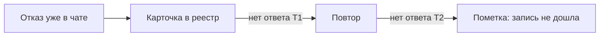
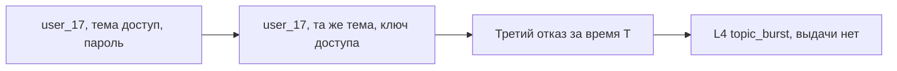

# Заявка на проектирование информационной системы

**Дисциплина:** Архитектура и разработка информационных систем  
**Автор:** Трюх Екатерина Александровна  
**Дата составления:** 5 октября 2026 г.  
**Версия:** 1.8 (файл списка, экраны ролей, журнал после нескольких отказов)  
**Статус:** заявка на согласование темы  

> Это только заявка. ТЗ по ГОСТ 34.602-2020 и комплект ГОСТ Р 56939-2024 пишутся после отметки «тема принята».

**Отметка о рассмотрении:**  
☐ тема принята  ☐ вернуть на доработку  

Дата ____  Подпись преподавателя ____

---

## 0. Рамка

| Норма | Зачем она здесь |
| --- | --- |
| **ГОСТ 34.602-2020** | Тема, роли и граница для будущего ТЗ |
| **ГОСТ Р 59793-2021** | Сейчас стадия формирования требований |
| **ГОСТ Р 56939-2024** | Позже учебный объём безопасной разработки по этой границе |
| **ГОСТ Р 58412** | Позже стыки Webhook и API войдут в модель угроз |
| Требования курса | Отметка «тема принята», затем ТЗ и прототип на сертифицированной ОС |

Класс защищённости объекта КИИ не ставится. Это учебный стенд.

| № | Что должно получиться | Где |
| --- | --- | --- |
| Ц-1 | При опасной фразе система сама отказывает в выдаче ответа и пишет полную карточку | § 1–2, § 11 |
| Ц-2 | Роли, экраны, правила A/B/C, Webhook и API | § 3–6, § 8 |
| Ц-3 | Заготовка разделов 2–4 будущего ТЗ | вся заявка |
| Ц-4 | Названы стыки и граница | § 8, § 11 |
| Ц-5 | Прототип на Astra / РЕД ОС / Альт 8 СП | § 12 |

Статья **FlippedRAG** ([arXiv:2501.02968](https://arxiv.org/abs/2501.02968), код [Zenodo 10.5281/zenodo.17036325](https://doi.org/10.5281/zenodo.17036325)) показывает: опасный текст уже лежит в документе, и модель его повторяет. Фильтр ищет в этом тексте фразу из списка («пароль», «ключ доступа», «закрытый узел»). Список один раз записывает администратор объекта. Из статьи он не берётся.

---

## 1. Тема

**Тема:** «Информационная система контроля вывода локальной модели на объекте КИИ: поиск опасной фразы в тексте документа, отказ в выдаче ответа и полный журнал причины».

**Краткое имя:** ИС «Вывод → Реестр».

Сотрудник пишет в чат локальной модели. Форм нет. Фильтр до выдачи ответа читает текст документа и ищет фразу из списка («пароль», «ключ доступа», «закрытый узел»).

Фразы нет — в чате ответ модели. Любая найденная фраза — система отказывает в выдаче: текст модели в чат не попадает, сотрудник видит «ответ отклонён».

В базу пишется карточка, по которой потом видно, почему отказали:

| Поле | Пример |
| --- | --- |
| Время | 5 октября 2026, 11:40 |
| Id пользователя | `user_17` |
| Вопрос | «Как войти в узел?» |
| Тема | «доступ» |
| Найденная фраза | «пароль» |
| Кусок документа | «…пароль хранится в файле узла…» |
| Код | `danger_phrase` |
| Уровень | L3 |

Специалист не дежурит у очереди. Он открывает журнал, когда ему нужно разобрать случаи.

Список хранится на компьютере стенда, в папке модуля «Фильтр», в файле `config/settings.txt`. Одна фраза — одна строка: «пароль», «ключ доступа», «закрытый узел». В том же файле лежат N, T, T1, T2, адрес реестра и токен. В базу реестра файл не копируется. Фильтр читает его при старте. Администратор меняет его с экрана «Правила».

Правила три.

**A. Уровень и причина.** Фразы нет — L1, код `pass`, ответ выдаётся. Фраза есть, например «пароль», — L3, код `danger_phrase`, выдачи нет. В карточку пишутся id пользователя, вопрос, фраза и кусок документа вокруг неё.

**B. Запись карточки.** Отказ в чате уже сделан. Если реестр не принял карточку за T1, фильтр отправляет её ещё раз. Если не принял и за T2, на стенде остаётся пометка «запись не дошла». Специалиста это не вызывает на смену: он увидит пометку, когда откроет журнал.

**C. Накопление по теме.** N отказов `danger_phrase` одного пользователя по одной теме за время T — следующий ответ становится L4, код `topic_burst`, выдачи снова нет. В карточке видно, какие прошлые фразы уже были.

В системе: фильтр, список фраз («пароль», «ключ доступа», «закрытый узел»), база карточек, экран просмотра.

Вне системы: формы сотрудника, дежурство у всех отказов, id документов, оценка смысла текста, обучение модели.

---

## 2. Назначение

**Сотрудник** пользуется локальной моделью. Если в документе есть фраза списка («пароль», «ключ доступа», «закрытый узел»), ответ ему не выдаётся. **Специалист** в любой момент открывает журнал и видит, кому, на какой вопрос и из-за какой фразы отказали.

Чат и модель на объекте уже есть. Фильтр и реестр — два модуля, на стенде на одном компьютере. Список фраз лежит в файле `config/settings.txt` модуля «Фильтр». Таймеры T1 и T2 относятся только к повторной записи карточки, не к работе специалиста.

---

## 3. Роли, объекты, экраны

### 3.1. Роли

У каждой роли свой экран. В одну очередь они не садятся.

| Роль | Экран | Через что работает | Что делает |
| --- | --- | --- | --- |
| Сотрудник | Чат | Уже открытый чат локальной модели | Пишет вопрос. Видит ответ или строку «ответ отклонён». Журнал ему не показан |
| Специалист | Журнал, затем карточка | Открывает журнал сам, когда решил разобрать отказы | Ставит фильтр, открывает строку, читает причину |
| Аудитор | Журнал, затем карточка | Тот же журнал | Только читает. Сохранять и править не может |
| Администратор | Правила | Экран «Правила» на компьютере фильтра | Один раз записывает фразы («пароль», «ключ доступа», «закрытый узел»), N, T, T1, T2, URL и токен. Журнал отказов не открывает |

### 3.2. Объекты

| Объект | Поля |
| --- | --- |
| Документ | текст, по которому собран ответ |
| Список фраз | Файл `config/settings.txt` в папке модуля «Фильтр». Строки: «пароль», «ключ доступа», «закрытый узел». В том же файле N, T, T1, T2, URL, токен. В реестр не копируется |
| Карточка отказа | время, id пользователя, вопрос, тема, фраза, кусок документа, код, уровень |
| Доставка | время, повтор, дошла ли запись |

| Код | Когда |
| --- | --- |
| `pass` | ни одной фразы списка в тексте нет, ответ выдан |
| `danger_phrase` | найдена фраза, например «пароль», выдача запрещена |
| `topic_burst` | у этого пользователя по теме уже N отказов за время T, выдача запрещена |

Запись `pass` в реестр не уходит. Любой другой код — отказ в выдаче и полная карточка.

### 3.3. Экраны

| Экран | Кто | Что на экране |
| --- | --- | --- |
| Чат | Сотрудник | Поле вопроса, кнопка «Отправить», ниже ответ модели или одна строка «ответ отклонён» |
| Журнал | Специалист, аудитор | Фильтр: дата, id пользователя, фраза. Таблица: время, id, тема, фраза, код, уровень, дошла ли запись |
| Карточка | Специалист, аудитор | Кто спросил, что спросил, какая фраза, кусок документа. При L4 ещё прошлые фразы |
| Правила | Администратор | Поле фраз, поля N, T, T1, T2, URL, токен, кнопка «Сохранить» |

Кнопок «разрешить этот ответ» нет. Журнал нужен для разбора уже сделанных отказов.

Чат устроен так: сотрудник пишет вопрос и нажимает «Отправить». Если фразы нет, ниже появляется текст ответа. Если фраза есть, ниже появляется только «ответ отклонён». Сколько бы отказов ни было, строка каждый раз одна и та же. Фразу, уровень и журнал сотрудник не видит. После отказа он может только задать другой вопрос.

Журнал устроен так: специалист открывает одну страницу со списком. Чтобы увидеть несколько отказов одного человека, ставит в фильтр его id, например `user_17`. Строки идут по времени. У обычного отказа код `danger_phrase` и уровень L3. Если по этой теме за время T отказов уже N, последняя строка имеет код `topic_burst` и уровень L4. Клик по строке открывает карточку. Если реестр не принял запись, в той же строке стоит пометка «запись не дошла». Отдельного экрана аварии нет.

---

## 4. Уровни

| Уровень | Условие | Чат | База |
| --- | --- | --- | --- |
| L1 | Фразы списка нет | Ответ выдан | `pass`, в реестр не уходит |
| L3 | Есть фраза, например «ключ доступа» | Выдачи нет | полная карточка, код `danger_phrase` |
| L4 | У этого пользователя по теме уже N отказов L3 за время T | Выдачи нет | полная карточка, код `topic_burst` и список прошлых фраз |

N = 3. T, T1, T2 — минуты. Точные значения — в ТЗ. Уровня L2 нет. При L3 и при L4 выдача запрещена одинаково.

---

## 5. Схема

| Стык | Куда | Что передаёт |
| --- | --- | --- |
| Текст документа | Поиск объекта → фильтр | Текст, в котором ищут фразы |
| Webhook | Фильтр → реестр | Полная карточка отказа |
| Повтор | Фильтр → реестр | Та же карточка, если первая отправка не дошла |

Если реестр не принял карточку, сотрудник всё равно уже получил отказ.

После этой схемы люди расходятся по своим экранам.

Сотрудник на схеме заканчивает. В чате уже стоит «ответ отклонён». Второй и третий отказ выглядят для него так же: та же строка, без номера и без причины. Журнал он не открывает.

Специалист на схеме начинается. Он сам открывает журнал и в фильтре ставит id, например `user_17`. Видит строки по времени: «пароль» L3, «ключ доступа» L3, затем строка L4 `topic_burst`. Открывает последнюю и читает вопрос, фразы и куски документа. Если у строки пометка «запись не дошла», это значит, что повтор за T1 и T2 не помог. Специалист только читает пометку. На смену его никто не вызывает.

---

## 6. Правила

**A. Уровень и причина.**

**B. Запись карточки.**

**C. Накопление.**

Три отказа — один и тот же id пользователя и одна тема. В каждой карточке своя фраза и свой кусок документа.

---

## 7. Проблемы

| ID | Сейчас | Что делает система |
| --- | --- | --- |
| П-1 | Текст с «пароль» доходит до сотрудника | Выдача ответа запрещена |
| П-2 | Опасность сидит в тексте документа | A ищет фразы списка до выдачи |
| П-3 | В журнале только слово, без того, кто спрашивал и где оно стояло | Карточка: id пользователя, вопрос, фраза, кусок документа |
| П-4 | Три отказа одного человека по одной теме не связаны | C ставит L4, `topic_burst` |
| П-5 | Чтобы понять причину, надо дежурить у чата | Специалист открывает журнал, когда нужно |
| П-6 | Запись отказа может не дойти | B повторяет отправку |

---

## 8. Стыковка

| Канал | Назначение |
| --- | --- |
| Текст документа | В нём ищутся «пароль», «ключ доступа», «закрытый узел» |
| Webhook | Полная карточка. Адрес из белого списка URL |
| Журнал вызовов | Время, адрес, код ответа. Секретов нет |

На стенде текстом может быть абзац из журнала FlippedRAG. На объекте — текст, который поиск уже отдал модели. Проверка одна и та же.

---

## 9. Сценарии

**1. Чисто.** В документе нет «пароль», «ключ доступа», «закрытый узел» → L1, `pass`. Ответ выдан. Карточки нет.

**2. Фраза есть.** В тексте есть «пароль». Система не выдаёт ответ. В карточке: `user_17`, вопрос «Как войти в узел?», фраза «пароль», кусок «…пароль хранится в файле узла…», код `danger_phrase`. Специалист видит это, когда откроет журнал.

**3. Три отказа.** Тот же `user_17`, тема «доступ»: сначала «пароль», потом «ключ доступа», третий за время T → L4, `topic_burst`. В чате сотрудник три раза видит одну и ту же строку «ответ отклонён». Специалист в журнале по фильтру `user_17` видит эти строки подряд и в последней карточке читает три фразы и три куска документа.

---

## 10. Функции

| Код | Функция |
| --- | --- |
| Ф-1 | Принять текст документа и id пользователя |
| Ф-2 | Найти в тексте «пароль», «ключ доступа» или «закрытый узел» |
| Ф-3 | При любой найденной фразе запретить выдачу ответа |
| Ф-4 | Записать карточку: время, id пользователя, вопрос, тема, фраза, кусок документа, код, уровень |
| Ф-5 | Отправить карточку в реестр и повторить, если она не дошла |
| Ф-6 | Поднять уровень до L4 при N отказах одного пользователя по одной теме |
| Ф-7 | Показать журнал с фильтром по дате, id пользователя и фразе |
| Ф-8 | Хранить список фраз, URL и токен в файле `config/settings.txt` |

---

## 11. Граница

| Где | Что |
| --- | --- |
| Внутри | Фильтр, список из трёх фраз, полная карточка отказа, журнал просмотра, L1/L3/L4, правила A/B/C, Webhook |
| Рядом | Чат, локальная модель, текст документа |
| Снаружи | Формы сотрудника, дежурная проверка каждого отказа, id документов, оценка смысла, обучение модели |

Остаются при любом сокращении: фильтр, список («пароль», «ключ доступа», «закрытый узел»), отказ в выдаче, карточка с id пользователя и куском документа, правила A/B/C, служба не от имени суперпользователя.

Стенд: один компьютер, два модуля, три фразы, N = 3, один HTTP-канал. Живая модель не нужна: хватает готового абзаца.

---

## 12. ОС

| ОС | Решение | Почему |
| --- | --- | --- |
| **Astra Linux Special Edition (серт.)** | Основной вариант | Режим защиты ближе к контуру КИИ |
| РЕД ОС (серт.) | Пока нет | Слабее как гипотеза режима объекта |
| Альт 8 СП | Пока нет | Выше риск нехватки пакетов |

Редакция и номер сертификата — после принятия темы.

Прошу рассмотреть заявку. При любой фразе из списка система не выдаёт ответ и пишет карточку: кто спросил, что спросил, какая фраза и в каком месте документа она стояла. Специалист смотрит этот журнал, когда ему нужно.
