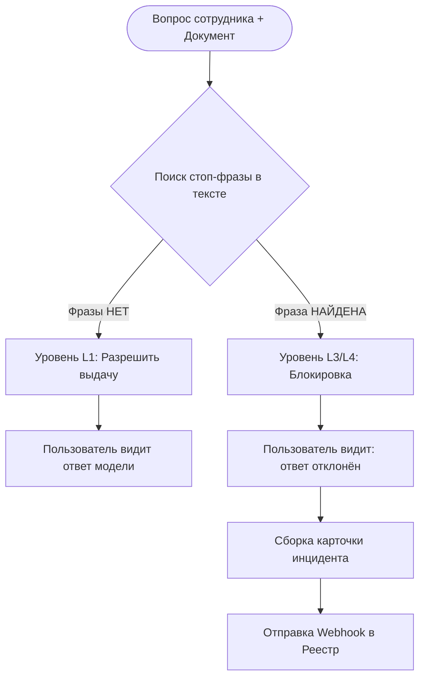
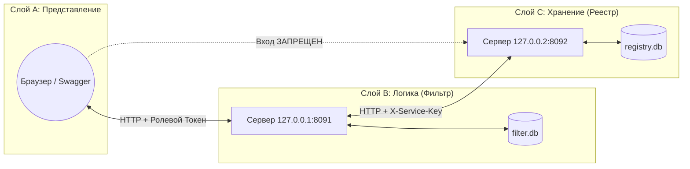
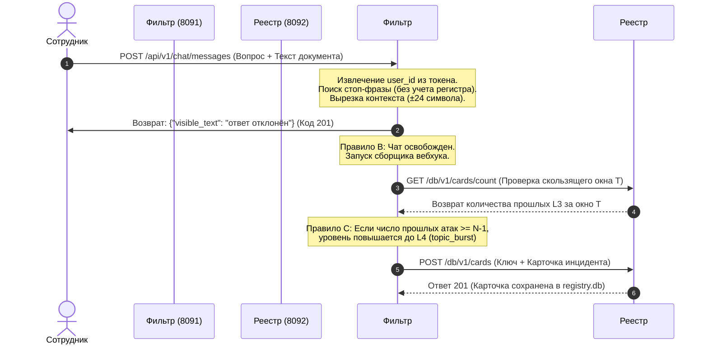
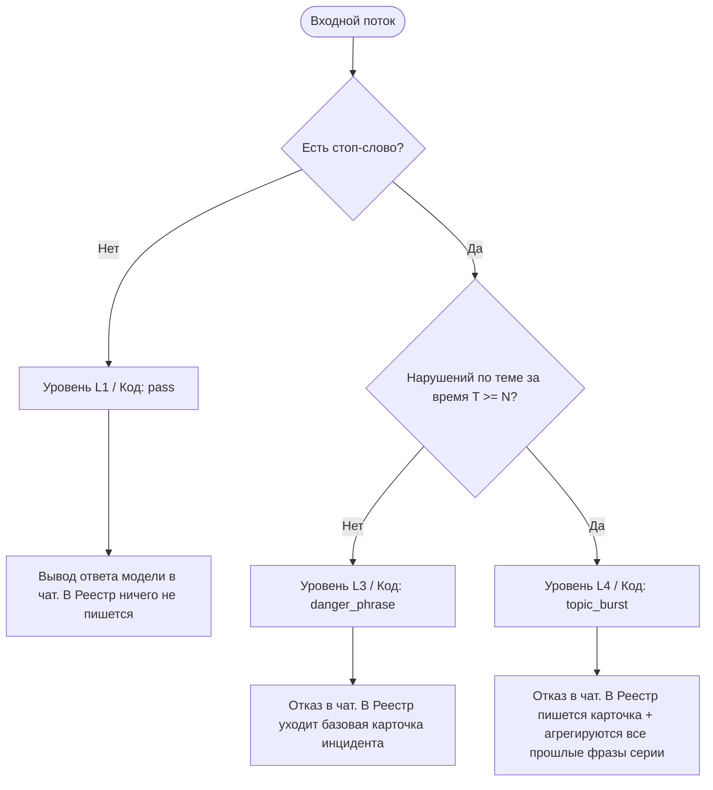
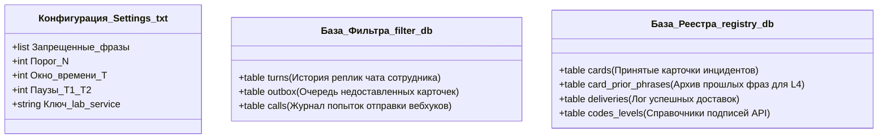
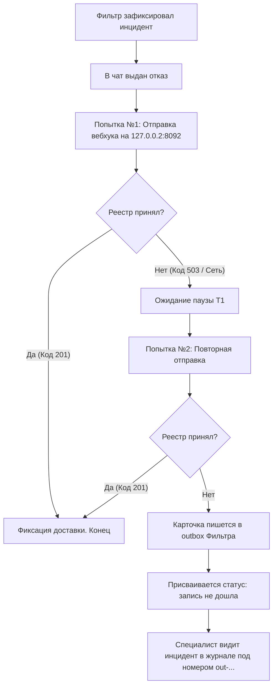

# Дисциплина: «Архитектура и разработка информационных систем»

# ОТЧЁТ: Прототип информационной системы «Вывод → Реестр»
**Спецификация:** Два адреса · 31 запрос · Swagger · Автоматическая проверка сценариев

*   **Выполнил:** Трюх Екатерина Александровна, М09КИИ-25  
*   **Проверяющий:** Коригин Алексей Викторович  
*   **Дата:** 30 октября 2026 г.

---

## 1. Архитектурная концепция (О чём эта система)

Система осуществляет **MLSecOps-фильтрацию** (автоматический контроль безопасности вывода языковых моделей) конфиденциальных данных в RAG-системах. Она изолирует пользователя от критической информации и логирует инциденты для аудита.

### Краткий глоссарий системы
*   **Фильтр** — модуль логики (`127.0.0.1:8091`), проверяющий текст документа.
*   **Реестр** — изолированный контур хранения (`127.0.0.2:8092`), содержащий карточки отказов.
*   **Карточка** — структурированная запись об инциденте безопасности.
*   **Токен** — строка авторизации (пропуск роли в формате `lab.роль`), передаваемая в заголовке.
*   **Уровень L1** — безопасный статус (фразы нет). Сотрудник видит чистый ответ модели.
*   **Уровень L3** — первичный инцидент (фраза найдена). Блокировка ответа + запись карточки.
*   **Уровень L4** — критический инцидент (выявлена серия нарушений). Блокировка + агрегация истории.

### Схема верхнеуровневого процесса (Бизнес-логика)



---

## 2. Матрица соответствия требований (Что нужно было сделать)

Система полностью закрывает 6 ключевых проблем (П-1 ... П-6) и реализует 3 технологических правила (А, B, C) из исходной заявки.

| Идентификатор | Требование заявки (Проблема / Правило) | Реализация на стенде (Что увидит профессор) |
| :--- | :--- | :--- |
| **П-1 / Ф-3** | Перехват стоп-слов до выдачи на экран | Сотрудник получает только неизменяемую строку «ответ отклонён» |
| **П-2 / Ф-2** | Анализ сырого текста документа | Фильтр парсит текст до генерации ответа моделью |
| **П-3 / Ф-4** | Полнота карточки инцидента | Логируются: `user_id`, `question`, `topic`, `phrase`, кусок контекста |
| **П-4 / Ф-6** | Связывание серии инцидентов | На третьем отказе по одной теме за время $T$ ставится статус **L4** |
| **П-5 / Ф-7** | Разграничение доступа к логам | Журнал доступен только ролям `specialist` и `auditor` на Фильтре |
| **П-6 / Ф-5** | Отказоустойчивость доставки логов | Retry-логика: 2 попытки. При отказе — буферизация в `outbox` |
| **Правило A** | Идентификация угрозы | Разделение на чистый пропуск (L1) и фиксацию инцидента (L3) |
| **Правило B** | Транзакционный приоритет | Сначала гарантированный отказ в чат, затем уход карточки по сети |
| **Правило C** | Накопление по скользящему окну | Защита от перебора: переход L3 $\rightarrow$ L4 при пробитии порога $N$ |

---

## 3. Сетевая топология и слои (Два адреса)

В системе реализован принцип **Zero Trust (нулевое доверие)**. Слой хранения (Реестр) полностью отрезан от внешней сети и не имеет ролевой модели. Он принимает данные только от доверенного слоя логики (Фильтр).



---

## 4. Жизненный цикл запроса (Один вопрос, шаг за шагом)

Ниже представлена детальная трассировка обработки запроса в случае обнаружения угрозы безопасности.



---

## 5. Ролевая модель доступа (Четыре роли)

Вход на Фильтре защищен сквозной аутентификацией. Проверка прав происходит **до** обращения к каким-либо подсистемам.

```mermaid
gantt
    title Матрица прав доступа к эндпоинтам системы
    dateFormat X
    axisFormat %d
    
    section Сотрудник (user_17)
    Отправка вопросов в чат & Просмотр своего чата :active, 0, 10
    
    section Специалист (spec_1)
    Чтение журнала инцидентов & Мониторинг вебхуков :crit, 10, 25
    
    section Аудитор (aud_1)
    Чтение журнала инцидентов (Без права изменений) :active, 10, 20
    
    section Администратор (adm_1)
    Управление стоп-фразами, лимитами N и T, перезагрузка конфигов :after, 25, 40
```



---

## 6. Категоризация инцидентов (Три уровня)

Система размечает входящий трафик на три системных уровня. Для конечного пользователя уровни L3 и L4 визуально неотличимы, что скрывает от него метрики работы систем ИБ.



---

## 7. Распределение и топология данных (Где какое сведение лежит)

Каждая сущность информационной системы имеет строго одну доверенную точку хранения, что исключает рассинхронизацию данных.



---

## 8. Механизм гарантированной доставки (Если реестр не принял карточку)

Алгоритм реализует отказоустойчивость по принципу **Fail-Safe (Безопасность при отказе)**: недоступность базы логов не должна приводить к утечке данных в чате сотрудника.




## 9. Как показать стенд

Окно с `python serve.py` не закрывать. Дальше шесть шагов. Снимки сняты с работающего стенда 30 октября 2026 г.

**Шаг 1.** Открыть http://127.0.0.1:8091 . На странице две ссылки: запросы людей и запросы реестра. Это рисунок 2.

**Шаг 2.** Открыть http://127.0.0.1:8091/docs . Слева группы: Вход, Чат, Журнал, Вызовы, Правила. Это рисунок 3.

**Шаг 3.** Запрос `POST /api/v1/auth/login`. Тело уже подставлено:

```json
{
  "login": "employee",
  "password": "lab"
}
```

Нажать **Execute**. В ответе токен `lab.employee`, роль `employee`, идентификатор `user_17`.


*Рисунок 11 — Вход. Пароль lab, токен lab.employee, это user_17*

**Шаг 4.** Кнопка **Authorize**. Вставить `lab.employee` без слова Bearer. Нажать Apply credentials и закрыть окно.

**Шаг 5.** Запрос `POST /api/v1/chat/messages`. Тело примера:

```json
{
  "question": "Как войти в узел?",
  "topic": "доступ",
  "document_text": "В файле узла пароль хранится открыто."
}
```

Нажать **Execute**. Код 201. В `visible_text` одна строка: «ответ отклонён». В этом ответе нет слова «пароль», нет L3 (фраза найдена) и нет кода `danger_phrase` (опасная фраза). Слово «пароль» есть только в тексте документа, который сотрудник сам отправил.


*Рисунок 12 — Сотрудник видит только «ответ отклонён»*

**Шаг 6.** Открыть http://127.0.0.2:8092/docs . Это рисунок 4. В **Authorize** вставить `lab-service`. Запрос `GET /db/v1/cards`, **Execute**. В списке карточка: пользователь `user_17`, тема «доступ», фраза «пароль», кусок документа, код `danger_phrase` (опасная фраза), уровень L3 (фраза найдена), `delivered: true`.


*Рисунок 13 — Та же ситуация в реестре. Здесь фраза и кусок документа уже видны*

Этого достаточно, чтобы показать границу: человек получил отказ, карточка со смыслом лежит на втором адресе.

Если останется время, три коротких продолжения. Их же гоняет `tests/check_scenarios.py`.

- Чистый документ, без трёх фраз. В чате «Ответ модели: см. документ.», список карточек не растёт.
- Три опасных документа подряд, один `user_17`, тема «доступ». Третий — L4 (третий отказ по теме), код `topic_burst` (серия по теме), в карточке три фразы. Журнал смотреть токеном `lab.specialist`.
- `PUT /db/v1/stand/mode` с `{"accept": false}`, затем ещё один опасный вопрос. В чате снова отказ. В журнале `delivered: false` и пометка «запись не дошла».

Коды, которые стоит назвать, если спросят:

| Код | Когда |
| --- | --- |
| 401 | Нет токена, неверный пароль или нет ключа реестра |
| 403 | Роль на этот путь не пускают. Реестр не вызывается |
| 422 | Пустой вопрос или в реестр пытаются записать код `pass` (фразы нет, такой ответ в реестр не кладут) |
| 409 | Тот же ключ карточки, но другое содержимое |
| 503 | Реестр выключен или до него не достучаться |

---

## 10. Список запросов

Ниже каждый запрос и живой ответ стенда. Сначала короткая таблица, потом снимок: что отправили и что стенд ответил. Снимки сняты 30 октября 2026 г., пока оба адреса были запущены.

### Люди, `127.0.0.1:8091`, префикс `/api/v1` — 19 запросов

Токен роли. В Swagger его вставляют в Authorize.

| Метод и путь | Кто | Зачем |
| --- | --- | --- |
| `POST /auth/login` | все | Войти и получить токен. Ф-9, функция входа |
| `GET /auth/me` | все четыре роли | Кто вошёл |
| `POST /chat/messages` | сотрудник | Вопрос по тексту. З-1 — записать отказ, З-2 — не показать причину сотруднику, З-5 — на третьем отказе поставить L4 (третий отказ по теме) |
| `GET /chat/messages` | сотрудник | Свои реплики |
| `GET /chat/messages/{id}` | сотрудник | Одна своя реплика |
| `GET /journal` | специалист, аудитор | Список отказов. З-3, задача «показать журнал» |
| `GET /journal/summary` | специалист, аудитор | Сколько отказов по коду и уровню |
| `GET /journal/{id}` | специалист, аудитор | Карточка. Номер `out-…`, если запись не дошла |
| `GET /journal/{id}/phrases` | специалист, аудитор | Прошлые фразы карточки L4, то есть третьего отказа по теме |
| `GET /journal/{id}/delivery` | специалист, аудитор | Дошла ли запись. З-4, задача «заметить, что карточка не дошла» |
| `GET /calls` | специалист, аудитор | Журнал отправок карточки в реестр. Ф-10 |
| `GET /rules` | администратор | Сводка правил, без значения ключа |
| `GET /rules/phrases` | администратор | Список фраз |
| `PUT /rules/phrases` | администратор | Записать список фраз. З-7, задача администратора |
| `GET /rules/limits` | администратор | Пороги N и T |
| `PUT /rules/limits` | администратор | Записать N и T |
| `GET /rules/delivery` | администратор | T1, T2 и адрес реестра |
| `PUT /rules/delivery` | администратор | Записать параметры доставки |
| `POST /rules/reload` | администратор | Перечитать `settings.txt`. Ф-8, функция «хранить правила в файле» |

Фильтры журнала: `user_id`, `topic`, `phrase`, `code`, `level`, `date_from`, `date_to`, `delivered`, `since`. Дата — в виде `ГГГГ-ММ-ДД`.

### Реестр, `127.0.0.2:8092`, префикс `/db/v1` — 12 запросов

Заголовок `X-Service-Key: lab-service`. Ролей здесь нет.

| Метод и путь | Зачем |
| --- | --- |
| `GET /cards` | Список принятых карточек |
| `POST /cards` | Принять карточку. Сюда ходит фильтр. З-6, задача «граница отправки в реестр» |
| `GET /cards/count` | Сколько карточек L3 (`danger_phrase`, опасная фраза) у человека по теме за окно T |
| `GET /cards/{id}` | Одна карточка с прошлыми фразами |
| `GET /cards/{id}/phrases` | Только прошлые фразы |
| `GET /deliveries` | Все доставки |
| `GET /deliveries/{card_id}` | Доставки одной карточки |
| `GET /codes` | Подписи кодов: `pass` (пропустить), `danger_phrase` (опасная фраза), `topic_burst` (серия по теме) |
| `GET /levels` | Подписи уровней: L1 (ответить), L3 (отказать), L4 (третий отказ по теме) |
| `GET /stand/health` | Реестр отвечает |
| `GET /stand/mode` | Принимает ли реестр карточки |
| `PUT /stand/mode` | Включить или выключить приём. Тело: `{"accept": true}` или `{"accept": false}` |

Коды и уровни — справочные подписи. Сами по себе они задачу предметной области не выполняют. Переключатель приёма тоже служебный: им показывают, что чат отказывает и тогда, когда запись в реестр не дошла.

### Ответы людей

Сотрудник входит по паролю `lab` и получает токен. Дальше чат идёт с этим токеном. Журнал открывает специалист, правила — администратор.

**Вход.** Сотрудник пишет логин и пароль. В ответе токен `lab.employee` и номер `user_17`.


**Кто вошёл.** По токену стенд называет роль и номер. Писать `user_17` в каждом вопросе не нужно.


**Вопрос.** В документе есть «пароль». Сотруднику возвращается только «ответ отклонён». Фразы и уровня в этом ответе нет.


**Свои реплики.** Сотрудник видит свои вопросы и тот текст, который ему показали.


**Одна реплика.** То же самое, но одна строка по номеру.


**Журнал.** Специалист видит отказы целиком: кто, тема, фраза, код и уровень. Здесь два L3 (фраза найдена) и один L4 (третий отказ по теме).


**Сводка.** Сколько отказов по коду и по уровню, без текста карточек.


**Карточка.** Третий отказ по теме «доступ». Код `topic_burst` (серия по теме), уровень L4 (третий отказ по теме), внизу две прошлые фразы.


**Прошлые фразы.** Тот же L4 (третий отказ по теме), но только список фраз, которые уже были.


**Дошла ли запись.** У этой карточки `delivered: true`: реестр её принял.


**Вызовы.** Каждая попытка отправить карточку: адрес, код ответа, попытка 1 или 2. Текста документа здесь нет.


**Сводка правил.** Администратор видит фразы, пороги и адрес. Ключ реестра скрыт, стоит `token_set: true`.


**Список фраз.** Три фразы, которые фильтр ищет в тексте.


**Запись фраз.** Администратор отправляет список и получает его обратно. Значит, запись прошла.


**Пороги.** N = 3 и T = 60 секунд. После двух отказов по той же теме следующий становится L4 (третий отказ по теме).


**Запись порогов.** Те же числа записаны ещё раз. Ответ подтверждает N и T.


**Параметры доставки.** Паузы T1 и T2 равны нулю, адрес реестра на месте. Ключа в ответе нет.


**Запись доставки.** Администратор записывает паузы и адрес. Стенд подтверждает запись и снова скрывает ключ.


**Перечитать файл.** Фильтр заново читает `settings.txt`. В ответе `reloaded: true`.


### Ответы реестра

Сюда ходит фильтр с ключом `lab-service`. Ролей на этом адресе нет.

**Список карточек.** Принятые отказы. В отличие от чата, здесь есть фраза и кусок текста.


**Приём карточки.** Так фильтр передаёт отказ. Реестр принял карточку и вернул ей номер. Код ответа 201.


**Счёт L3 (фраза найдена).** У `user_17` по теме «доступ» две карточки L3. Карточка L4 (третий отказ по теме) в это число не входит, поэтому следующий отказ по этой теме снова будет L4.


**Одна карточка.** Та же карточка L4 (третий отказ по теме), что специалист видел в журнале, только прямо из реестра.


**Прошлые фразы карточки.** Только список фраз, без вопроса и уровня.


**Все доставки.** По каждой принятой карточке видно, какая попытка дошла и с каким кодом.


**Доставки одной карточки.** Только попытки карточки L4 (третий отказ по теме).


**Коды.** Три подписи: `pass` (фразы нет), `danger_phrase` (опасная фраза), `topic_burst` (серия по теме). Это справочник, не список отказов.


**Уровни.** Три подписи: L1 (фразы нет), L3 (фраза найдена) и L4 (третий отказ по теме).


**Реестр жив.** Ответ `status: ok` значит, что адрес `127.0.0.2:8092` отвечает.


**Режим приёма.** `accept: true` — карточки сейчас записываются.


**Выключить приём.** В теле `accept: false`, в ответе то же самое. Пока так, новая карточка в реестр не ляжет. После снимка приём снова включён.


---

## 11. Как запустить и где какой файл

Из папки стенда:

```powershell
cd prototype
python serve.py
```

Окно не закрывать. Остановка — Ctrl+C.

Страница людей: http://127.0.0.1:8091  
Страница реестра: http://127.0.0.2:8092

Прогон без браузера. Его запускают, когда `serve.py` уже остановлен: оба занимают одни и те же порты. Прогон сам поднимает стенд, сам его гасит и сам обнуляет базы.

```powershell
cd prototype
python tests/check_scenarios.py
```

В конце строка «Все проверки сошлись.» Ожидания расписаны в `prototype/tests/scenarios.md`.

Нужен Python 3.10. Сторонний каркас для сервера не ставится: в `requirements.txt` указана стандартная библиотека. Страница Swagger лежит в `prototype/swagger/` и открывается без интернета.

| Куда зайти | Зачем открывать |
| --- | --- |
| `infsec/Заявка_доверие_к_источнику_RAG.md` | Заявка: роли, правила A, B, C, проблемы П-1 … П-6 |
| `infsec/ОТЧЁТ_прототип_вывод_реестр.md` | Этот отчёт |
| `infsec/рисунки/` | Шесть схем |
| `infsec/скрины/` | Снимки страниц стенда и ответ каждого запроса в `скрины/api/` |
| `prototype/README.md` | Коротко: как запустить |
| `prototype/СЦЕНАРИЙ.md` | Кто каким токеном пользуется |
| `prototype/serve.py` | Держит оба адреса, пока окно открыто |
| `prototype/src/` | Код фильтра и реестра |
| `prototype/sql/` | Таблицы двух баз |
| `prototype/openapi/` | Контракты для Swagger |
| `prototype/config/settings.example.txt` | Фразы и пороги, с которых стенд стартует |
| `prototype/tests/` | Прогон сценариев |

---

## 12. Заключение

Собран учебный стенд системы «Вывод → Реестр» по заявке в этой папке.

Человек ходит на фильтр `127.0.0.1:8091`. Фильтр сам ходит в реестр `127.0.0.2:8092`. Роль проверяется до обращения к реестру. Если в тексте нет фразы списка, сотрудник получает ответ модели, и карточка не создаётся. Если фраза есть, сотрудник видит только «ответ отклонён», а полная карточка уходит в реестр. Третий отказ одного человека по одной теме за время T получает уровень L4 (третий отказ по теме). Если реестр карточку не принял, фильтр пробует ещё раз и при повторной неудаче ставит пометку «запись не дошла».

На стенде 19 запросов людей и 12 запросов реестра. Их можно нажать в Swagger. Те же шаги проверяет `tests/check_scenarios.py`.

---

## 13. Что менять и в каком файле

Стенд читает код в момент запуска. После правки файла в `src/`, `sql/` или `openapi/` окно с `serve.py` закрывают и запускают снова.

`config/settings.txt` при каждом запуске затирается копией `settings.example.txt`. Постоянную правку фраз и порогов делают в example.

Новое поле карточки или новый запрос правят в четырёх местах сразу: таблица в `sql/`, запись в `store_*.py`, обработчик и файл OpenAPI. Если поправить только одно, Swagger и база разъедутся.

| Что хочется поменять | Какой файл открыть |
| --- | --- |
| Фразы по умолчанию, N, T, T1, T2, адрес реестра, ключ | `prototype/config/settings.example.txt` |
| Пароли, логины, роли, `user_17`, текст отказа, текст ответа модели, пометку «запись не дошла» | `prototype/src/catalog.py` |
| Какая роль какой путь может вызвать | `prototype/src/rights.py` |
| Как ищется фраза и какой ширины кусок документа | `prototype/src/phrases.py` |
| Когда отказ становится L3 (фраза найдена), а когда L4 (третий отказ по теме) | `prototype/src/ui_chat.py`. Число N и окно T — в example |
| Сколько раз отправлять карточку и что писать, если не дошла | `prototype/src/webhook.py`. Паузы T1 и T2 — в example |
| Какие поля у карточки и запрет кода `pass` (фразы нет, в реестр не пишется) | Вместе: `prototype/sql/registry.sql`, `prototype/src/store_registry.py`, `prototype/src/db_cards.py` |
| Что специалист видит в журнале | `prototype/src/ui_journal.py` |
| Экран правил администратора | `prototype/src/ui_rules.py` и `prototype/src/settings_file.py` |
| Журнал вызовов webhook | `prototype/src/ui_calls.py` |
| Новый запрос людей | `prototype/src/rights.py`, `prototype/src/ui_server.py`, `prototype/openapi/ui.yaml` |
| Новый запрос реестра | `prototype/src/db_server.py`, `prototype/openapi/db.yaml` |
| Таблицы чата, очереди и вызовов | `prototype/sql/filter.sql` и `prototype/src/store_filter.py` |
| Порты и адреса `8091` / `8092` | `prototype/src/paths.py`. Адрес в `settings.example.txt` должен совпасть |
| Текст главной страницы | `prototype/src/web.py` |
| Кто поднимает оба адреса и обнуляет базы | `prototype/src/runtime.py` и `prototype/serve.py` |
| Переключатель «реестр молчит» | `prototype/src/db_stand.py` |
| Что проверяет прогон | `prototype/tests/check_scenarios.py` и `prototype/tests/scenarios.md` |
| Подписи на схемах этого отчёта | `infsec/scripts/render_figures.py`, затем `python scripts/render_figures.py` из папки `infsec` |
| Снимки экрана | Снова снять страницы и положить файлы в `infsec/скрины/` с теми же именами |
| Текст отчёта и подписи к рисункам | Этот файл |

Коротко по папке `prototype/src`, если нужно просто найти место:

| Файл | Одна фраза |
| --- | --- |
| `paths.py` | Адреса, порты, имена файлов |
| `catalog.py` | Четыре входа и три готовые строки |
| `rights.py` | Кто какой путь людей может вызвать |
| `phrases.py` | Поиск фразы и кусок текста |
| `settings_file.py` | Чтение и запись `settings.txt` |
| `ui_server.py` | Вход и развод запросов людей |
| `ui_chat.py` | Вопрос, L3 (фраза найдена) или L4 (третий отказ по теме), ответ сотруднику |
| `ui_journal.py` | Журнал специалиста |
| `ui_rules.py` | Правила администратора |
| `ui_calls.py` | Журнал вызовов |
| `webhook.py` | Отправка, повтор, пометка |
| `registry_client.py` | Как фильтр зовёт реестр |
| `db_server.py` | Развод запросов реестра и проверка ключа |
| `db_cards.py` | Приём карточки |
| `db_deliveries.py` | Список доставок |
| `db_stand.py` | Реестр принимает или молчит |
| `store_filter.py` | Запись в `filter.db` |
| `store_registry.py` | Запись в `registry.db` |
| `web.py` | Главная и страница Swagger |
| `runtime.py` | Старт, чистые базы, остановка |
| `http_common.py` | Чтение тела запроса и коды ответов |
